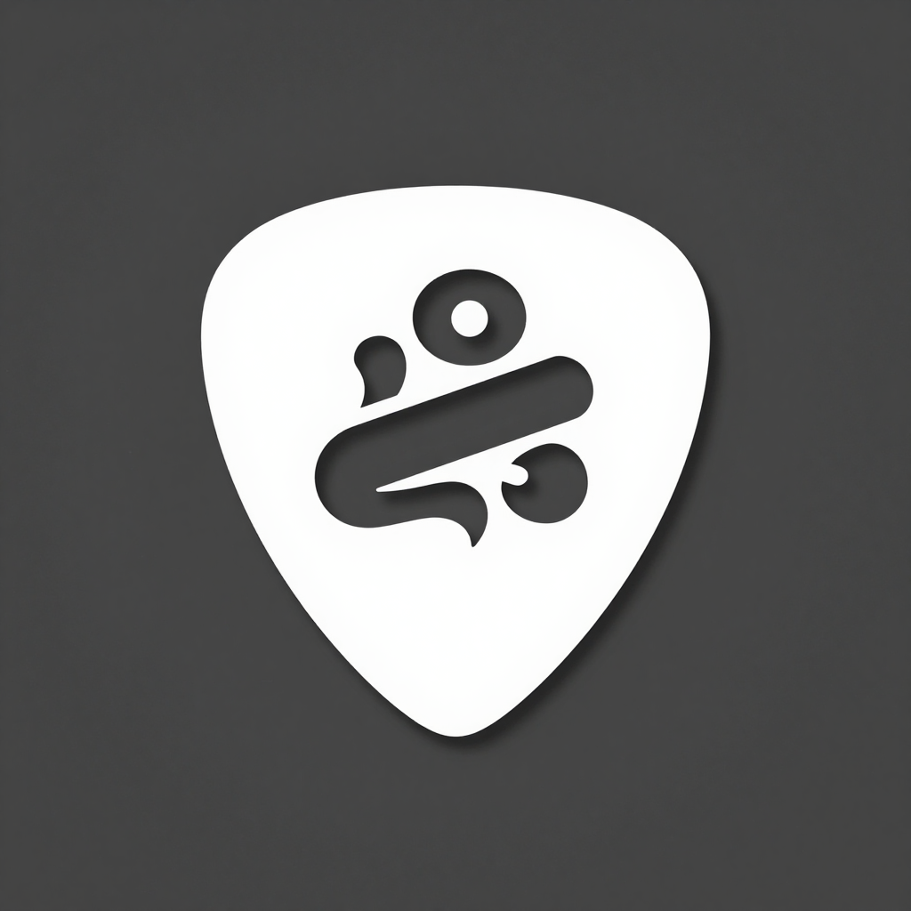

<div align=center>

<h2>音乐助手</h2>
</div>

### 一、产品概述

- 跨平台调音器与和弦识别工具，支持 Android 与 iOS。
- 调音器基于 MPM（McLeod Pitch Method）做实时音高检测，偏差以音分（cent）显示。
- 和弦识别基于 chroma 特征与和弦模板匹配，输出根音、类型、置信度与转位。
- 内置 9 种预设调弦，支持自定义调弦的增删。
- 中英双语界面。

核心价值：

- 调音与和弦两个页面共用同一路录音和同一次分析，录音只启动一次。
- 原生 DSP 跑在独立 isolate 中，重计算不阻塞 UI 线程。
- 原生库缺失时自动降级为空结果，App 不崩溃。

### 二、功能说明

#### 调音器

- 指针式表盘配合上下两枚 LED 指示灯，偏差进入容差范围时亮绿灯。
- 显示当前音名、八度、频率与音分偏差。
- 9 种预设调弦：标准吉他、降半音、Open D、Open G、标准贝斯、五弦贝斯、标准尤克里里、标准小提琴、标准大提琴；可增删自定义调弦。

#### 和弦识别

- 显示和弦符号、类型名称、根音与低音（用于判断转位）。
- 同时列出理论构成音，以及实际检测到的各音级强度（强度 > 5% 才显示）。
- 12 维 chroma 条形图可视化。
- 5 帧多数投票平滑，抑制结果抖动。

#### 设置

- 容差（音分）、调弦选择与管理、界面语言。

### 三、技术架构

- Flutter + Riverpod 2（StateNotifier），经 dart:ffi 调用原生 C++ DSP 库。
- 原生库包含：MPM 音高检测、HPS 多音高检测、radix-2 Cooley-Tukey FFT、chroma 特征提取、和弦模板匹配。
- 分析在独立 isolate 中进行：8192 样本环形缓冲，每 2048 样本（hop）分析一次；音高检测取最近 4096 样本，和弦识别使用完整 8192 样本。
- C API 全部采用出参风格，不在 C 与 Dart 之间转移内存所有权。
- 原生库加载失败时 DspBridge 降级为空结果。

#### 各平台原生库接入

| 平台 | 接入方式 |
| --- | --- |
| Android | `android/app/build.gradle.kts` 的 `externalNativeBuild` 直接编译 `native/dsp/CMakeLists.txt` |
| iOS | 根目录 `MusicHelperDSP.podspec` 并在 `ios/Podfile` 注册 pod，借助 `use_frameworks!` 编成动态框架，符号由 `DynamicLibrary.process()` 解析 |

### 四、快速上手

环境要求：Flutter SDK（stable 通道）、Android Studio 或 Xcode。

```bash
flutter pub get
flutter run       # 连接设备后运行
flutter analyze   # 静态检查
flutter test      # 44 个单元测试与 Widget 测试
```

重新生成应用图标（源文件为根目录 `icon.png`）：

```bash
dart run flutter_launcher_icons
```

### 五、构建与部署

```bash
flutter build apk --release        # Android APK
flutter build appbundle --release  # Android AAB
flutter build ios --release        # iOS（需配置签名团队）
```

推送到 `main` 分支会触发 GitHub Actions（`.github/workflows/build.yml`），自动执行 analyze 并构建 APK / AAB / iOS 产物后上传。原生 DSP 的算法正确性由独立验证程序覆盖，音高误差小于 0.1 音分。

### 六、开发进度

- [X] MPM 音高检测
- [X] HPS 多音高检测
- [X] FFT 与 chroma 特征提取
- [X] 和弦模板匹配（含转位判断）
- [X] 调音器界面（表盘 / LED / 音分偏差）
- [X] 和弦识别界面（构成音 / 检测音 / chroma 图）
- [X] 9 种预设调弦与自定义调弦
- [X] 中英双语
- [X] 后台 isolate 分析
- [X] Android 与 iOS 原生库接入
- [X] 单元测试与 Widget 测试

### License

本项目采用 [GNU General Public License v3.0](LICENSE) 授权。

Copyright (C) 2026 Mutantcat
